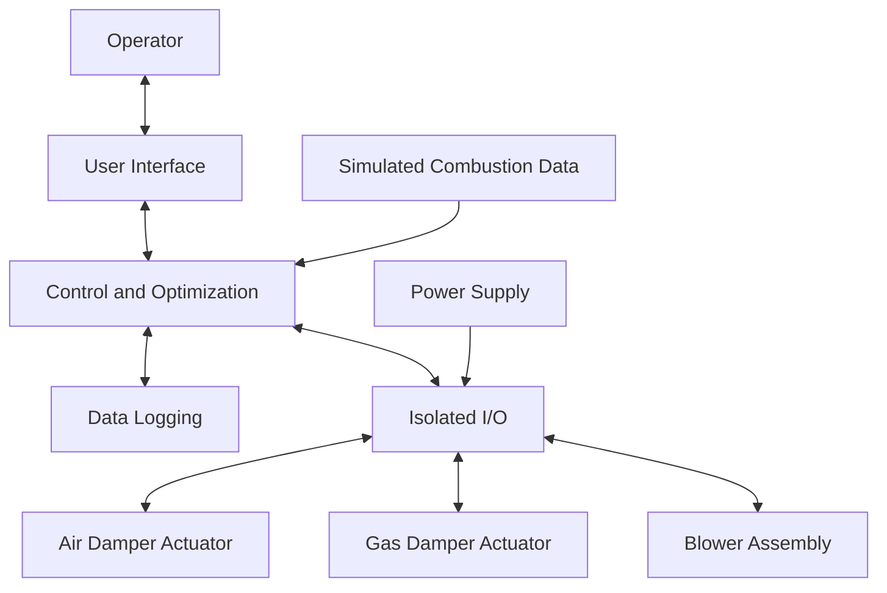
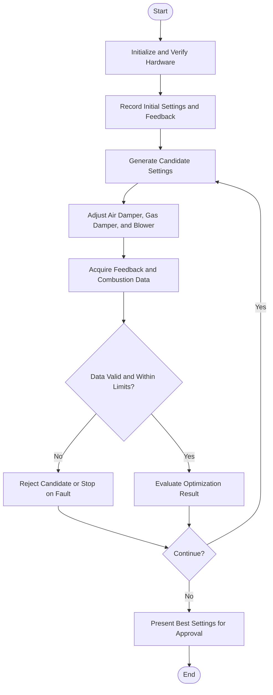
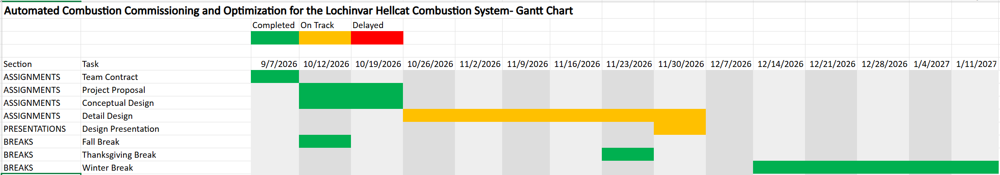
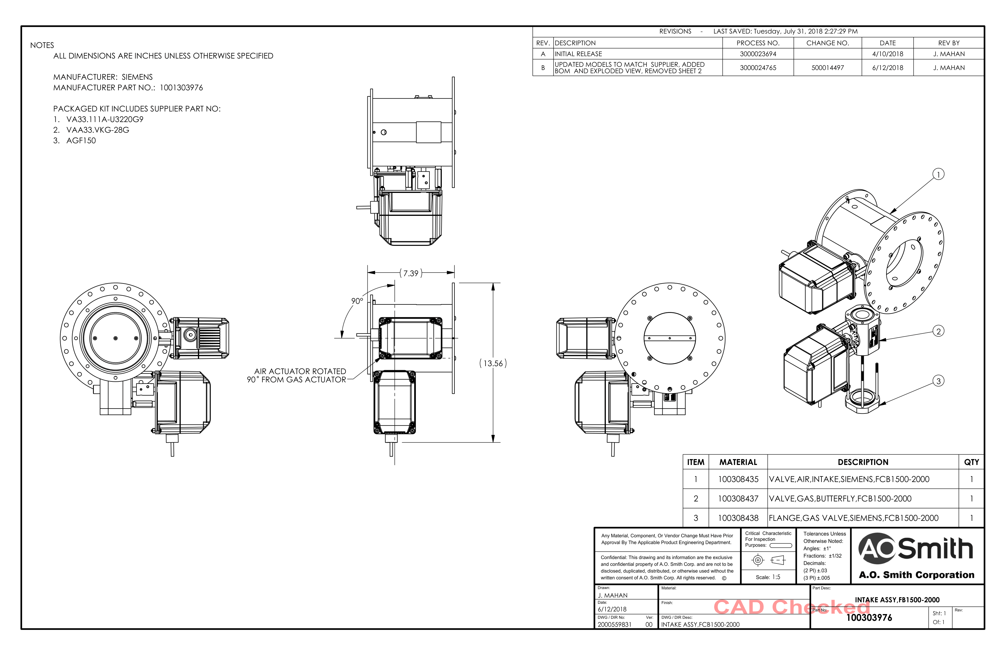
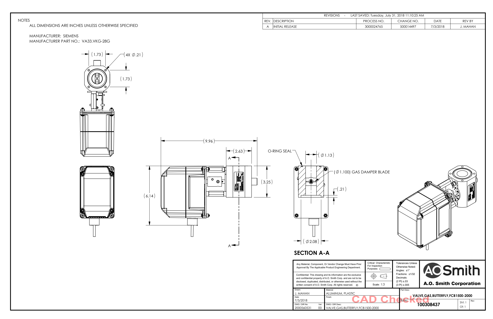
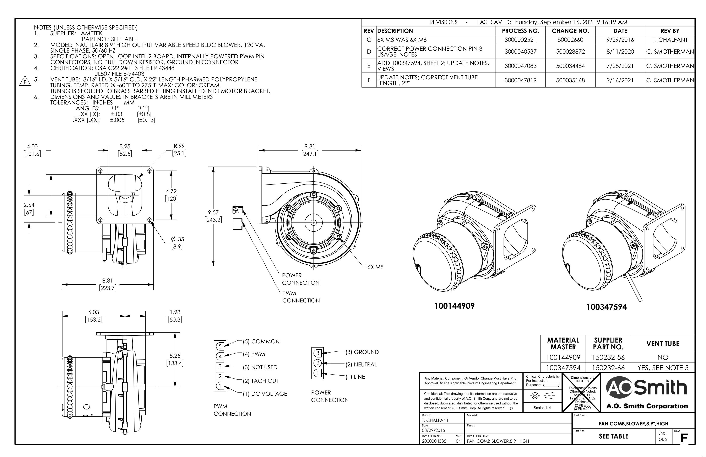

# Midterm Design
## Automated Combustion Commissioning and Optimization for the Lochinvar Hellcat Combustion System
#### Customer: Lochinvar Corporation
#### Instructor: Christopher Johnson
#### Project Supervisor: Ben Putnam
#### Team Members: Daniel Craig, Charles Lutz, Alex Marquez, Ethan Davenport
#### Course: ECE 4961 Capstone Design 1
#### Date: 10/20/2026

---

## 1. Introduction

The project will develop a prototype that reduces the time and effort required to determine and document appropriate air-damper, gas-damper, and blower settings for the Lochinvar Hellcat combustion assembly. Hellcat already incorporates combustion-control functions, including independent air and gas control and oxygen feedback. The project is not intended to replace the factory burner-management system or develop a new safety controller. It will investigate whether a separate commissioning tool can organize the adjustment process, collect actuator and blower data, evaluate candidate settings, and produce a repeatable record for review by qualified personnel.

A key project constraint is that **the student project will not use gas and will not fire the burner**. Testing will therefore use the supplied physical intake assembly and blower, verified electrical interfaces, actuator-position feedback, tachometer feedback, simulated sensor values, and/or recorded data. The prototype can demonstrate safe command generation, motion control, data logging, and optimization logic without claiming that a setting has been proven safe or optimal under combustion. Any later combustion validation would require a separately authorized activity outside the scope of this gas-free project.

The supplied hardware includes the Lochinvar/A. O. Smith intake assembly, Siemens air and gas actuator references, and the A. O. Smith 8.9-inch blower assembly (part 100144909). The project must verify the actual connector pinouts, signal levels, command methods, travel limits, feedback scaling, and permitted interfaces before energizing or commanding any component. Manufacturer drawings and the Hellcat service documentation take precedence over assumptions based on similar products.

### 1.1 Project goals

The prototype is intended to:

- Make the commissioning workflow more systematic and easier to repeat.
- Control or command the permitted air/gas damper and blower variables through verified interfaces.
- Measure actuator feedback and blower tachometer feedback where those signals are available.
- Accept simulated or recorded combustion measurements, including O₂ and CO, for algorithm development.
- Evaluate candidate settings against configurable constraints rather than optimizing one measurement in isolation.
- Log commands, feedback, test conditions, errors, and results.
- Generate a commissioning-style report that clearly distinguishes simulated data from physical measurements.
- Preserve human review and avoid bypassing or replacing factory safety controls.
- Demonstrate operation without fuel, flame, or live combustion.

## 2. Restatement of the Fully Formulated Problem

Commissioning a combustion system can require evaluating multiple operating points and finding appropriate relationships between air and fuel settings. Manual adjustment can be time-consuming and may produce inconsistent documentation. The project will develop a gas-free prototype that automates the controllable portions of this workflow and demonstrates how an optimization tool could support a qualified technician.

### 2.1 Requirements (“shall” statements)

|    ID&nbsp;&nbsp;&nbsp;&nbsp;&nbsp;    | Requirement |
|:--------|:---|
| R-01 | The prototype **shall** provide a repeatable workflow for setting up, running, stopping, and reviewing a commissioning-style test. |
| R-02 | The prototype **shall** interface with the supplied physical hardware only through electrical interfaces verified against the exact component documentation and/or measurements approved by the supervisor. |
| R-03 | The prototype **shall** provide independently addressable command channels for the air actuator, gas actuator, and blower if those functions are included in the final hardware configuration. |
| R-04 | The prototype **shall** acquire and timestamp available actuator feedback, blower tachometer feedback, controller commands, and system status. |
| R-05 | The prototype **shall** accept simulated or recorded O₂, CO, CO₂, temperature, pressure, and modulation data for algorithm testing when live combustion measurements are unavailable. |
| R-06 | The optimization software **shall** reject candidate settings that exceed configured command, travel, speed, or data-validity limits. |
| R-07 | The software **shall** detect missing, stale, implausible, or out-of-range feedback and stop issuing new optimization commands when required feedback is invalid. |
| R-08 | The prototype **shall** include a readily accessible stop function that halts new commands and places outputs in a defined, documented state. The correct safe state shall be determined from the actuator and electrical-interface documentation; the software shall not assume that removing power is safe for every mechanism. |
| R-09 | The prototype **shall not** use gas, ignite a burner, or conduct live-combustion testing as part of this project. |
| R-10 | The prototype **shall not** bypass, disable, or replace a factory burner-management system, flame-proving function, safety interlock, or required lockout. |
| R-11 | The prototype **shall not** autonomously authorize a real boiler for commercial operation or represent simulated results as validated combustion results. |
| R-12 | The system **shall** log the date/time, test identifier, software/configuration version, requested settings, measured feedback, simulated/recorded inputs, errors, rejected candidates, and selected result. |
| R-13 | The system **shall** generate a report containing the tested settings, constraints, data source, optimization result, known limitations, and test status. |
| R-14 | The design **shall** electrically isolate or appropriately condition signals wherever required by the verified voltage levels, grounding arrangement, noise environment, or component documentation. |
| R-15 | The team **shall** compare the automated workflow with a documented baseline workflow using measurable criteria such as completion time, command/feedback error, repeatability, and completeness of records. |
| R-16 | The team **shall** verify hardware behavior first on a bench with fuel isolated and the burner unable to fire, before integrating software-controlled motion. |
| R-17 | The design **shall** retain a manual approval step before any candidate settings are marked as accepted. |
| R-18 | The team **shall** document unresolved interface assumptions and shall not energize a component until its supply requirements, connector pinout, and command/feedback signals are confirmed. |

### 2.2 Stakeholders

**Lochinvar Corporation — Project Sponsor and Customer**

Lochinvar Corporation is the project's sole identified stakeholder and the intended recipient of the automated commissioning system. The project's requirements and measures of success are based on Lochinvar's needs and expectations.

Lochinvar's primary needs and interests include:

- **Automated Commissioning:** Reduce the manual effort required to adjust air and gas damper positions across the required modulation range.
- **Combustion Performance:** Identify operating settings that meet the approved combustion and performance requirements at the required operating points.
- **Repeatability:** Produce consistent commissioning results when testing is performed under equivalent operating conditions.
- **Data Collection:** Record relevant measurements, actuator positions, blower speed, modulation level, and operating conditions for analysis and verification.
- **Safety and Operating Limits:** Ensure the optimization process operates within approved equipment limits and does not bypass existing combustion safety functions.
- **Verification and Documentation:** Provide documented test results that demonstrate whether the system meets its specified performance requirements.

The project will address these needs by developing an automated process that evaluates operating conditions, adjusts permitted settings, records measurement data, and verifies results against defined acceptance criteria. Project specifications and verification procedures will be aligned with Lochinvar's requirements and reviewed with the project sponsor as needed.

### 2.3 Origins of constraints

| Constraint                                                   | Origin and design effect                                                                                                                     |
|:-------------------------------------------------------------|:---------------------------------------------------------------------------------------------------------------------------------------------|
| No gas or live firing                                        | Project scope and laboratory safety constraint. All tests use dry bench operation, simulated inputs, or recorded data.                       |
| Factory safety system remains authoritative                  | Manufacturer requirements, public safety, and professional engineering responsibility. The prototype is not a burner-management replacement. |
| Use the supplied Hellcat intake assembly and 8.9-inch blower | Customer-provided resources and project scope. Mechanical/electrical compatibility must be confirmed.                                        |
| Exact actuator interface not yet verified                    | Supplied component drawings and connector details must be reconciled before controller selection is finalized.                               |
| No source code for the existing controller                   | Sponsor constraint. The team will develop an independent application and use only documented, permitted interfaces.                          |
| Safe command limits and feedback validation                  | Electrical and mechanical safety; prevents unintended travel, overspeed, and invalid optimization results.                                   |
| Manufacturer limits govern all commissioning assumptions     | Customer and product documentation. No limits will be invented from a spreadsheet or inferred from another actuator model.                   |
| Student budget and schedule                                  | Course resource constraints. Existing lab instruments and sponsor-provided components will be used where available.                          |

### 2.4 Stakeholder Specifications

The following specifications preserve the intent of the Project Proposal while adapting verification to the controlling gas-free project scope.

| ID | Stakeholder need | Specification | Proposed target | Verification method |
|---|---|---|---|---|
| SS-01 | Automated commissioning workflow | The system shall evaluate every approved bench-test point in the test plan. | 100% of approved test points evaluated or explicitly marked failed/skipped with a reason. | Compare the run log with the approved test-point list. |
| SS-02 | Actuator positioning | The system shall command each supported actuator to a target position and report available position feedback. | Proposed target: ±0.1° only if supported by actuator resolution and verified measurement; otherwise document the achievable tolerance before acceptance testing. | Compare command and feedback against a calibrated reference or verified position signal. |
| SS-03 | Blower control | The system shall command the blower through the verified interface and measure its tachometer response. | Proposed target: ±2% of target RPM where the hardware and measurement method support this tolerance. | Compare commanded RPM with measured RPM using a verified tachometer method. |
| SS-04 | Data collection | The system shall log required commands, feedback, test state, and input data with timestamps. | At least one complete record per second during active tests, subject to interface and logging performance. | Inspect log fields and timestamp intervals. |
| SS-05 | Measurement quality | The system shall document units, resolution, accuracy, and source for each measurement or simulated input used by the software. | Documentation completed for 100% of required channels. | Review datasheets, interface notes, and reference-instrument comparisons where applicable. |
| SS-06 | Repeatability | The system shall repeat selected bench tests under equivalent conditions and compare the results. | At least three runs per selected test condition; acceptance variation defined before testing. | Compare actuator positions, RPM, recorded inputs, and computed outputs across runs. |
| SS-07 | Commissioning efficiency | The system shall measure the time required to execute the defined automated bench-test sequence. | Record a baseline and automated duration; a 20% reduction is a proposed goal only if a comparable manual baseline is available. | Time equivalent procedures and document differences in test coverage. |
| SS-08 | Operating limits and safety | The system shall reject commands outside configured bench-test limits and shall not enable burner firing or fuel flow. | Zero accepted out-of-range commands; burner firing prohibited throughout project testing. | Test boundary values and review state, command, and fault logs. |
| SS-09 | Fault handling | The system shall detect defined simulated sensor, feedback, and communication faults and stop or inhibit the affected sequence. | 100% detection of the defined fault-injection cases. | Introduce faults in a controlled bench or simulation environment and verify the response. |
| SS-10 | Documentation | The system shall produce a record for each completed test run. | 100% of completed runs have a corresponding record with inputs, commands, feedback, status, and faults. | Inspect generated logs and reports against a required-field checklist. |

These targets are preliminary where marked as proposed. They do not establish certified actuator accuracy, combustion performance, or safe operating limits. Final acceptance values require sponsor review and hardware verification.

## 3. Comparative Analysis of Potential Solutions

The project considered five conceptual architectures. The comparison focuses on gas-free prototyping, the ability to interface with multiple components, development effort, cost, and future extensibility.

| Option                                                        | Description                                                                                                                    | Advantages                                                                                               | Disadvantages / risks                                                                                                                       | Assessment                                                                                                                    |
|:--------------------------------------------------------------|:-------------------------------------------------------------------------------------------------------------------------------|:---------------------------------------------------------------------------------------------------------|:--------------------------------------------------------------------------------------------------------------------------------------------|:------------------------------------------------------------------------------------------------------------------------------|
| A. Manual-only test and spreadsheet                           | Technician moves hardware manually and records readings in a spreadsheet.                                                      | Lowest cost; minimal interface electronics; useful as a baseline.                                        | Does not demonstrate automated motion, interlocks in software, or repeatable data acquisition.                                              | Retain as a comparison baseline, not the final prototype.                                                                     |
| B. Microcontroller with isolated I/O                          | MCU-based controller, signal conditioning, position/tach inputs, and a separate user-interface computer.                       | Deterministic I/O; relatively low cost; good for pulse timing and command generation.                    | More custom firmware and interface design; more work to build a convenient report/UI workflow.                                              | Feasible alternative if interface timing or electrical noise requires it.                                                     |
| C. Single-board computer plus dedicated interface electronics | A Raspberry Pi-class computer runs the UI, logging, and optimization; isolated driver/input hardware handles physical signals. | Strong Python/data-analysis support; low-cost UI and report generation; easy to develop and demonstrate. | Linux is not a hard real-time controller; GPIO is not industrial I/O; all physical signals need suitable interface hardware and validation. | **Preferred conceptual architecture**, with time-critical pulse generation delegated to suitable hardware if necessary.       |
| D. Industrial PLC/controller                                  | PLC with industrial I/O and HMI.                                                                                               | Rugged I/O ecosystem; predictable control behavior; familiar industrial architecture.                    | Higher cost; programming/licensing overhead; may be excessive for a gas-free student prototype.                                             | Preferred only if the sponsor requires industrial hardware or the final interface cannot be implemented safely with Option C. |
| E. Direct modification of factory burner controller           | Modify factory firmware or insert commands into safety-critical logic.                                                         | Potentially direct access to internal signals.                                                           | Source code unavailable; high safety/certification risk; risks compromising factory protections.                                            | **Rejected.** The project will not modify or bypass factory safety logic.                                                     |

### 3.1 Selected solution

Option C is selected as the initial architecture: a single-board computer for the operator interface, data logging, reporting, and optimization, combined with dedicated, electrically appropriate interface hardware for actuator and blower signals. This selection keeps the software accessible while acknowledging that raw computer GPIO is not a suitable direct interface to unknown industrial signals.

The controller selection remains conditional on verification of the actual hardware interfaces. The team will first identify the exact electrical behavior of the VA33.11A-U3220G9 air actuator, VA33.VKG-28G gas actuator, and 100144909 blower. If the actuator command requires timing accuracy or electrical characteristics that the selected computer cannot reliably provide, a microcontroller or industrial I/O module will generate the low-level signals while the computer remains the supervisory application.

Previous discussions have identified the Siemens LMV37.400Ax/LMV37.420Ax and OCI412.10 interface as possible communication options for future evaluation. They are not confirmed as the selected solution: compatibility with the supplied VA33 actuators, access to the required commissioning parameters, and suitability for the gas-free test scope must be verified from the applicable documentation. The factory controller must remain responsible for its intended control and safety functions; the student prototype will not bypass or replace those functions. The team will not assume that an LMV37, OCI412, SQM33, or other controller/interface is compatible simply because it is associated with Siemens combustion equipment.

## 4. High-Level Solution

The prototype is divided into six subsystems:

1.  Operator interface and workflow.
2.  Supervisory computer and optimization software.
3.  Actuator command and feedback interface.
4.  Blower command and tachometer interface.
5.  Sensor/data-input and simulation subsystem.
6.  Logging, reporting, and test validation.

The prototype will have two operating modes:

- **Bench hardware mode:** commands and reads only verified physical interfaces, with fuel isolated and no possibility of burner firing under the approved test setup.
- **Simulation/replay mode:** uses generated or recorded measurement data to test optimization logic, safety bounds, report generation, and error handling without relying on a combustion event.

The software will separate command generation from measurement evaluation. Candidate settings will be generated inside a bounded search space, checked against configuration limits, sent through the interface, and then evaluated only after the system reports a stable and valid state. Simulated O₂/CO data will be explicitly labeled as simulated or replayed. Since the project does not use gas, the prototype can validate software behavior and electromechanical response but cannot validate actual combustion quality, emissions, or burner performance.

### 4.1 Hardware block diagram

### Block Definitions

| Block | Function |
|---|---|
| Operator Interface | Configure tests, monitor status, and approve results. |
| Control and Optimization | Adjust damper positions and blower speed within defined limits. |
| Simulated Data | Provide combustion data for optimization testing. |
| Data Logging | Record commands, feedback, and optimization results. |
| Isolated I/O | Interface with hardware control and feedback signals. |
| Air Damper Actuator | Adjust air damper position. |
| Gas Damper Actuator | Adjust gas damper position during dry testing; no gas is connected. |
| Blower Assembly | Control blower speed and monitor tachometer feedback. |
| Power Supply | Provide appropriately rated power to the hardware. |

### 4.2 Operational flowchart

### 4.3 Operating States

| State | Behavior | Exit Condition |
|---|---|---|
| Initialization | Load configuration and verify hardware interfaces. | Hardware checks pass. |
| Baseline | Record initial actuator positions, blower speed, and available data. | Baseline recorded. |
| Optimization | Generate candidate settings and adjust the air damper, gas damper, and blower. | Candidate settings applied. |
| Measurement | Acquire feedback and simulated or recorded combustion data. | Data validity checked. |
| Evaluation | Check constraints, calculate the objective score, and log results. | Candidate accepted or rejected. |
| Stop/Fault | Stop new commands and log the fault when feedback or safety checks fail. | Operator review and reset. |
| Review | Present the best candidate and test report for manual approval. | Operator approves or rejects results. |

## 5. Atomic Subsystem Specifications

All numerical electrical values and command limits must be obtained from the exact manufacturer documentation or verified measurements before hardware commissioning. The specifications below define required behavior; they do not assume unverified actuator pinouts or calibration values.

### 5.1 Subsystem A — Operator interface and workflow

**Function:** Provide a clear operator workflow for selecting a mode, confirming prerequisites, starting/stopping a test, monitoring status, and reviewing results.

**Inputs**

- Operator commands and configuration values.
- System state, feedback, warnings, and faults from the supervisory application.
- Test profile and permitted operating bounds.

**Outputs**

- Start/stop requests.
- Approved test configuration.
- Status display and alerts.
- Report-review and export requests.

**Interfaces**

- Internal software API between UI and supervisory application.
- Local display and keyboard/mouse or touchscreen.
- No direct connection to actuator power or safety-critical hardware.

**Specifications**

- **UI-01:** The interface shall display the selected mode as `BENCH HARDWARE` or `SIMULATION/REPLAY`.
- **UI-02:** The interface shall require confirmation of the gas-isolated, burner-disabled test preconditions before each physical run.
- **UI-03:** The interface shall provide a persistent stop control during a run.
- **UI-04:** The interface shall display commanded and measured actuator positions and blower speed where available, with units and signal-source labels.
- **UI-05:** The interface shall display stale or invalid data as invalid rather than retaining it as if current.
- **UI-06:** The interface shall identify every simulated or replayed sensor value.
- **UI-07:** The interface shall require operator review before a candidate is marked accepted.
- **UI-08:** The interface shall show fault cause, timestamp, and required recovery action when known.
- **UI-09:** The interface shall prevent the user from configuring limits outside the verified hardware envelope without an explicit engineering configuration change.
- **UI-10:** The interface shall support exporting a report and raw data in a documented format such as CSV and PDF/HTML.

**Major functional sequence:** Load profile → show preconditions → run self-check → allow start → display live status → stop or finish → review warnings/results → export report.

### 5.2 Subsystem B — Supervisory computer and optimization software

**Function:** Coordinate the test, enforce command bounds, select candidate settings, evaluate data, and decide whether to continue or stop.

**Inputs**

- Operator configuration and run commands.
- Command/feedback data from the I/O subsystem.
- Simulated or recorded combustion measurements.
- Configured limits and objective-function weights.

**Outputs**

- Bounded actuator/blower commands.
- Requests for measurements and status.
- Candidate scores and accept/reject decisions.
- Fault and stop requests.
- Data records for logging.

**Interfaces**

- Internal software modules with versioned configuration.
- Serial, USB, Ethernet, or GPIO-connected interface hardware only as verified by the selected interface module.
- Any communication protocol used to a device must be confirmed from its datasheet; no protocol is assumed merely from a connector type.

**Specifications**

- **SW-01:** The application shall implement an explicit state machine with initialization, pre-check, ready, command, stabilization, measurement, evaluation, stop/fault, and review states.
- **SW-02:** The application shall validate all configuration values, units, bounds, and required fields before a run.
- **SW-03:** The optimization routine shall search only within a finite, configured set of allowed candidate values.
- **SW-04:** The routine shall apply hard safety and validity constraints before comparing objective scores.
- **SW-05:** The routine shall not select a candidate when required measurements are missing, stale, implausible, or outside their configured valid range.
- **SW-06:** The application shall use a configurable stabilization criterion and timeout. Values shall be set from bench measurements and supervisor review rather than guessed.
- **SW-07:** On a stop request, communication timeout, or invalid critical feedback, the application shall stop issuing new optimization commands and invoke the documented stop behavior.
- **SW-08:** The application shall not autonomously change safety-critical factory controller settings.
- **SW-09:** The application shall separate measured physical values, simulated values, and replayed values in storage and reports.
- **SW-10:** The application shall support deterministic replay of a saved test dataset so that algorithm changes can be compared against identical inputs.
- **SW-11:** The application shall log the objective-function version, configured constraints, software version, and candidate sequence.
- **SW-12:** The application shall be tested with unit tests for limit enforcement, timeouts, missing data, invalid sensor values, and stop behavior before physical motion tests.

**Optimization concept:** The algorithm will evaluate air-damper command, gas-damper command, and blower command as independent candidate variables only where the physical hardware and test plan permit. An objective function may score deviation from target values, repeatability, and operating smoothness. O₂/CO data used in the first phase will be simulated or replayed. Hard limits override any score: a candidate outside configured bounds or with invalid inputs is rejected regardless of its score.

### 5.3 Subsystem C — Actuator command and feedback interface

**Function:** Provide verified, independently addressable command and feedback paths for the supplied air and gas damper actuators.

**Inputs**

- Requested command from the supervisory computer.
- Actuator position/status feedback.
- Low-voltage supply and any required enable signals.

**Outputs**

- Electrical command signals appropriate to each exact actuator.
- Scaled and conditioned feedback to the supervisory computer.
- Interface fault/status signals where supported.

**Interfaces**

- Electrical command and feedback wiring from the verified Siemens actuator connectors.
- Digital pulse, direction, analog, or other interface only if explicitly supported by the exact part documentation.
- Isolated digital/analog inputs or a dedicated driver board as required by verified voltage and current ratings.

**Specifications**

- **ACT-01:** The team shall identify the exact pinout, supply voltage, maximum current, command method, travel limits, and feedback method for each supplied actuator before energizing it.
- **ACT-02:** The interface shall support separate commands for air and gas actuators if both are included in the selected test configuration.
- **ACT-03:** The interface shall condition signals to prevent a component’s voltage levels from exceeding the controller’s electrical ratings.
- **ACT-04:** The system shall enforce software travel/command limits based on verified mechanical endpoints and manufacturer documentation.
- **ACT-05:** The system shall compare requested movement with available feedback and flag a mismatch that exceeds a configured tolerance or timeout.
- **ACT-06:** The system shall not infer actual valve position solely from the commanded percentage.
- **ACT-07:** The system shall prevent commands when feedback is invalid or the physical test preconditions are not satisfied.
- **ACT-08:** The stop response and unpowered behavior shall be documented for each actuator before the first powered test.
- **ACT-09:** Position feedback shall be calibrated against verified reference points where the actuator provides suitable feedback.
- **ACT-10:** The team shall verify motion direction, travel range, repeatability, and endpoint behavior using a gas-isolated bench setup.

**Unknowns to resolve:** Exact connector pinouts and electrical ratings; whether position feedback is directly available; command resolution and travel mapping; safe behavior on power loss; whether separate driver electronics are required. These are critical design inputs, not values to be guessed.

### 5.4 Subsystem D — Blower command and tachometer interface

**Function:** Command the supplied 8.9-inch blower assembly and measure its speed where supported by the actual blower interface.

**Inputs**

- Requested blower command.
- Tachometer pulse signal or other speed feedback.
- Blower power and control supply.

**Outputs**

- Verified blower command signal.
- Calculated speed and feedback-validity status.
- Timeout or command/feedback mismatch indication.

**Interfaces**

- The sponsor-provided A. O. Smith blower assembly, part 100144909.
- Low-voltage control connector for PWM/tachometer signals if confirmed on the exact revision.
- Separate 120 VAC blower power path, physically and electrically separated from low-voltage control electronics.

**Specifications**

- **BL-01:** The team shall verify the exact blower model/revision, connector pinout, line-power requirements, control-signal voltage, PWM frequency/duty requirements, tachometer signal levels, and pulses per revolution.
- **BL-02:** The low-voltage controller shall not directly switch the blower’s AC line input unless a specifically rated and approved switching interface is designed for that purpose.
- **BL-03:** The interface shall use appropriate isolation, protection, and signal conditioning based on verified documentation.
- **BL-04:** The software shall convert tachometer pulses to speed only after the pulses-per-revolution scaling is verified.
- **BL-05:** The software shall detect loss of tachometer feedback and flag it instead of treating missing pulses as a valid speed measurement.
- **BL-06:** The team shall test command-to-speed response and repeatability under a gas-free bench setup.
- **BL-07:** The system shall enforce verified speed-command bounds and shall stop new optimization commands when feedback is invalid.
- **BL-08:** Any blower operating limits used in software shall come from the blower documentation and supervisor-approved test plan.

### 5.5 Subsystem E — Sensor, simulation, and data-input subsystem

**Function:** Supply physical actuator/blower feedback and simulated or recorded combustion variables to the supervisory application.

**Inputs**

- Physical position and tachometer feedback.
- Recorded datasets.
- Simulation configuration and operator-selected test profile.
- Optional measurements from approved laboratory instruments.

**Outputs**

- Timestamped, unit-labeled data values.
- Validity flags and source labels.
- Sensor plausibility warnings.

**Interfaces**

- Conditioned digital/analog input or documented communications protocol for physical feedback.
- CSV or another documented format for replayed datasets.
- Internal software interface for simulated O₂, CO, CO₂, temperature, pressure, and modulation values.

**Specifications**

- **DA-01:** Each data field shall include a name, unit, timestamp, and source identifier (`physical`, `simulated`, or `replayed`).
- **DA-02:** The system shall validate data type, range, timestamp, and freshness before using a value in optimization.
- **DA-03:** The system shall support replaying the same dataset repeatedly for regression testing.
- **DA-04:** Simulated combustion data shall be clearly marked in the user interface, stored record, and report.
- **DA-05:** The software shall not claim that simulated O₂ or CO values demonstrate actual combustion performance.
- **DA-06:** If a physical sensor is added, its range, accuracy, calibration interval, response time, output format, and interface shall be recorded before integration.
- **DA-07:** Missing or invalid critical data shall cause candidate rejection and may cause the run to stop according to the approved test configuration.
- **DA-08:** Time alignment between commands and measurements shall be sufficient to identify which feedback belongs to each candidate; the exact sampling rate shall be established during bench characterization.

### 5.6 Subsystem F — Data logging, reporting, and validation

**Function:** Preserve an auditable record of test configuration, commands, feedback, optimization decisions, and test outcomes.

**Inputs**

- Events and measurements from all software subsystems.
- Operator and test identifiers.
- Software version, configuration version, and source-data metadata.

**Outputs**

- Time-series log.
- Summary report.
- CSV export for analysis.
- Validation metrics and comparison plots/tables.

**Interfaces**

- Internal logging API.
- Local storage and removable/exported files.
- CSV for raw records and PDF/HTML or Markdown for human-readable reports.

**Specifications**

- **LOG-01:** Every run shall receive a unique test identifier.
- **LOG-02:** The log shall contain timestamps, commands, available feedback, data-source labels, candidate scores, accept/reject decisions, and faults.
- **LOG-03:** The report shall list the configured limits and the source used to establish them.
- **LOG-04:** The report shall state whether data were physical, simulated, or replayed.
- **LOG-05:** The report shall include a limitations section and shall not label a gas-free test as a successful combustion commissioning.
- **LOG-06:** Raw data shall be retained in a format that can be independently analyzed.
- **LOG-07:** The team shall compare manual-baseline and automated workflow time, command/feedback tracking error, repeated-run variation, data completeness, and fault-response behavior.
- **LOG-08:** Acceptance thresholds shall be agreed with the project supervisor before final testing and documented in the test plan.
- **LOG-09:** The logger shall preserve fault records when a run stops unexpectedly.
- **LOG-10:** The software shall not silently overwrite prior test results.

## 6. Ethical, Professional, Safety, and Standards Considerations

### 6.1 Public safety and professional responsibility

Combustion systems can create fire, explosion, high-temperature, and carbon-monoxide hazards. Because the project will not use gas or fire the burner, the design and test plan are constrained to dry bench operation and simulation/replay. The gas-free constraint is a project boundary, not proof that every electrical or mechanical activity is automatically safe. Actuators and the blower can still cause pinch, rotating-equipment, electrical, and stored-energy hazards.

The team shall:

- Keep fuel disconnected/isolated throughout project testing and verify the burner cannot fire.
- Obtain supervisor approval for wiring, energization, and mechanical-motion tests.
- Use manufacturer documentation to establish electrical and mechanical limits.
- Keep line-voltage blower wiring separated from low-voltage signal wiring.
- Use appropriate fusing, enclosures, strain relief, grounding, and signal isolation.
- Provide a stop function and document the physical output behavior on stop, timeout, and power loss.
- Never bypass the factory controller’s safety functions or represent the student prototype as a safety-rated control.
- Clearly label all simulated data and all reports as gas-free prototype results.
- Document unresolved risks, failed tests, and limitations honestly.

### 6.2 Standards and guidance

The team shall review the current editions and applicability of relevant requirements with the customer and project supervisor. Listing a standard does not by itself establish that the student prototype is certified or compliant.

| Standard / guidance                                                                   | Relevance to design                                                                                                                                                            |
|:--------------------------------------------------------------------------------------|:-------------------------------------------------------------------------------------------------------------------------------------------------------------------------------|
| Lochinvar Hellcat service and installation documentation                              | Primary source for permitted commissioning practices, operating limits, hardware configuration, and factory safety requirements.                                               |
| NFPA 54, National Fuel Gas Code                                                       | Relevant background for fuel-gas system safety; the project itself will not connect or use gas. Applicable requirements for the host system must be confirmed by the customer. |
| CSA/ANSI Z21.13 / CSA 4.9, gas-fired low-pressure steam and hot-water boilers         | Relevant to the host boiler’s product-safety context; not a claim of certification for the prototype. Confirm the edition applicable to the actual equipment.                  |
| NFPA 70, National Electrical Code                                                     | Relevant to electrical installation practices where applicable, including wiring and protection. The laboratory and supervisor determine applicable requirements.              |
| IEC 60204-1, Safety of machinery — Electrical equipment of machines                   | Useful guidance for electrical design, stop behavior, wiring, and machine-related hazards where applicable.                                                                    |
| ASHRAE Handbook, Fundamentals — combustion and fuels; Systems and Equipment — boilers | Technical background for combustion, excess air, and boiler performance. Simulated data cannot establish actual combustion performance.                                        |
| ASHRAE Standard 202, The Commissioning Process                                        | Useful process guidance for documentation, verification, issue tracking, and review; not a substitute for manufacturer commissioning instructions.                             |
| IEEE Code of Ethics                                                                   | Supports prioritizing public safety, disclosing limitations, avoiding misleading claims, and reporting results honestly.                                                       |

### 6.3 Environmental and economic impact

The long-term motivation is to reduce commissioning time, improve repeatability, and potentially improve combustion performance. Those benefits remain hypotheses until validated. Because the prototype will not fire the burner, the project cannot claim measured reductions in fuel use, emissions, or carbon monoxide. Its valid performance claims are limited to software behavior, command/feedback performance, repeatability of the dry test workflow, quality of records, and comparison of workflow time under the test conditions.

### 6.4 Data integrity and cybersecurity

The software shall distinguish physical readings from simulated and replayed data. Configuration files and test records shall identify their versions. The prototype shall not accept undocumented remote commands or expose physical outputs to an unprotected network. Communication loss or corrupted input shall stop new optimization commands and trigger the documented fault behavior.

## 7. Resources

### 7.1 Budget estimate

The sponsor has supplied an intake assembly and blower. Their reference values are listed as in-kind resources rather than new cash expenses. The following budget is a planning estimate for the gas-free prototype. Actual costs will depend on the verified interfaces and the equipment available through the university.

| Subsystem / item                               | Purpose                                               | Estimated cash cost | Notes                                                                     |
|:-----------------------------------------------|:------------------------------------------------------|--------------------:|:--------------------------------------------------------------------------|
| Supervisory computer                           | UI, optimization, logging, reports                    |          \$80–\$180 | Raspberry Pi-class computer or equivalent; use lab hardware if available. |
| Isolated I/O / interface electronics           | Command and feedback conditioning                     |         \$150–\$450 | Final amount depends on actuator interface verification.                  |
| Microcontroller / pulse-generation board       | Deterministic timing if required                      |          \$25–\$100 | Conditional; omit if dedicated I/O handles timing.                        |
| Low-voltage power supplies, protection, fuses  | Safe power for interface and actuator circuits        |          \$75–\$200 | Based on verified voltage/current requirements.                           |
| Wiring, connectors, enclosure, terminal blocks | Prototype assembly and strain relief                  |         \$100–\$250 | Connector types to be confirmed.                                          |
| Blower tach/PWM conditioning                   | Speed command and feedback interface                  |          \$40–\$150 | May be included in I/O budget; avoid double counting at procurement.      |
| Measurement and verification tools             | DMM, oscilloscope/logic analyzer, current measurement |           \$0–\$250 | Assume university lab access; purchase only missing tools.                |
| Test fixture and mechanical guarding           | Secure mounting and pinch/rotation protection         |          \$50–\$200 | Use existing lab fixture where possible.                                  |
| Contingency                                    | Unknown interface needs and replacement parts         |         \$100–\$250 | Spend only with team/supervisor approval.                                 |
| **Estimated cash total**                       |                                                       |   **\$620–\$2,030** | Excludes equipment already available from sponsor/university.             |

**In-kind sponsor hardware (reference value, not cash expenditure)**

| Qty. | Part                                                  | Reference value | Budget treatment           |
|-----:|:------------------------------------------------------|----------------:|:---------------------------|
|    1 | Intake assembly, part 100304496 (proposal cost sheet) |           \$952 | Sponsor-provided           |
|    1 | A. O. Smith 8.9-inch blower, part 100144909           |           \$497 | Sponsor-provided           |
|      | **Total in-kind reference value**                     |     **\$1,449** | Not included in cash total |

The budget excludes a combustion analyzer because live combustion testing is outside the project scope. If the university or sponsor already has instrumentation that is useful for electrical and mechanical verification, it should be borrowed rather than purchased. The budget must be updated after the I/O inventory and interface prototype determine which signal-conditioning parts are actually required.

### 7.2 Division of labor

The proposal identifies four team members but does not provide verified individual skill assessments. The allocation below assigns primary ownership by subsystem and must be confirmed by the team based on demonstrated skills and workload. Every subsystem remains subject to peer review.

| Team member      | Primary responsibility                      | Supporting responsibility / deliverables                                                                   |
|:-----------------|:--------------------------------------------|:-----------------------------------------------------------------------------------------------------------|
| Daniel Craig     | Actuator and blower electrical interface    | Connector/pinout inventory, signal-conditioning design, safe bench wiring, physical interface test record. |
| Charles Lutz     | Supervisory software and optimization logic | State machine, bounded candidate search, limit enforcement, unit tests, software versioning.               |
| Alex Marquez     | Data acquisition and validation             | Feedback scaling, simulation/replay inputs, dataset design, repeatability and validation metrics.          |
| Ethan Davenport  | Operator interface, logging, and reporting  | UI workflow, status/fault display, CSV/report generation, test documentation.                              |
| All team members | Integration and design review               | Requirements traceability, risk review, testing, final report, and presentation.                           |

**Required team skills and gaps:** The team shall complete a short skills inventory during the first design review. Embedded programming, electrical safety, controls, data analysis, and technical writing must each have a named primary and reviewer. Combustion expertise will be obtained from Lochinvar documentation and customer/supervisor consultation; the student team will not independently define live-combustion limits.

### 7.3 Timeline and Gantt chart

## 8. Verification and Acceptance Plan

| Test ID | Test                      | Method                                                                                                            | Evidence / acceptance basis                                                                                             |
|:--------|:--------------------------|:------------------------------------------------------------------------------------------------------------------|:------------------------------------------------------------------------------------------------------------------------|
| V-01    | Configuration validation  | Provide missing, malformed, and out-of-range configuration values.                                                | Run is blocked and a clear error is logged.                                                                             |
| V-02    | Command-limit enforcement | Request commands below, within, and above configured bounds.                                                      | Out-of-range commands are rejected before reaching the interface.                                                       |
| V-03    | Feedback scaling          | Compare reported actuator position and blower speed with an independent reference instrument or verified fixture. | Error is measured and compared with a tolerance set before testing.                                                     |
| V-04    | Stop behavior             | Trigger stop during idle, command, and stabilization states.                                                      | New optimization commands stop and the documented output state is reached.                                              |
| V-05    | Communication timeout     | Disconnect or simulate loss of feedback/communications.                                                           | Fault is raised; no new optimization commands are issued.                                                               |
| V-06    | Invalid sensor data       | Inject stale, missing, NaN, and out-of-range simulated values.                                                    | Candidate is rejected and the reason is recorded.                                                                       |
| V-07    | Replay repeatability      | Run the same saved dataset and configuration multiple times.                                                      | Candidate sequence and decisions match deterministically, except explicitly nondeterministic fields such as timestamps. |
| V-08    | Physical repeatability    | Repeat bounded dry actuator/blower tests under the same conditions.                                               | Command/feedback variation is measured and reported against a pre-agreed tolerance.                                     |
| V-09    | Report integrity          | Compare report entries with raw log data.                                                                         | Values, units, source labels, configuration, and fault records agree.                                                   |
| V-10    | Workflow comparison       | Time the documented baseline workflow and prototype workflow for equivalent dry-test tasks.                       | Completion time and data completeness are reported; no unsupported combustion benefit is claimed.                       |

The team shall define numeric tolerances after component specifications and bench measurements are available. Until those values are agreed and recorded, a test can be described as completed but cannot be called a quantitative pass.

## 9. Risk Register

| Risk                                              | Consequence                                      | Mitigation                                                                                                      |
|:--------------------------------------------------|:-------------------------------------------------|:----------------------------------------------------------------------------------------------------------------|
| Incorrect actuator pinout or voltage              | Component damage or unexpected motion            | Verify exact part drawing and pinout; current-limited/appropriately protected initial tests; supervisor review. |
| Command signal incompatible with actuator         | No movement or uncontrolled movement             | Characterize interface before final controller selection; use dedicated driver/interface if needed.             |
| Unexpected mechanical motion                      | Pinch injury or fixture damage                   | Secure the assembly, guard pinch points, keep hands clear, and provide a stop control.                          |
| Blower AC voltage reaches low-voltage electronics | Electric shock or equipment damage               | Separate line-voltage and signal circuits; use rated isolation and protection.                                  |
| Incorrect tach scaling                            | Wrong speed estimate and misleading optimization | Verify pulses per revolution and compare against independent measurement.                                       |
| Stale or simulated data treated as physical       | Invalid conclusions                              | Source labels, freshness checks, report disclaimers, and automated tests.                                       |
| Software fault issues repeated commands           | Mechanical damage                                | Hard command bounds, timeouts, state-machine interlocks, and independent stop procedure.                        |
| Schedule delayed by unknown interface             | Late integration                                 | Make interface verification the first critical milestone; keep a software-in-the-loop path available.           |
| Overstated project results                        | Misleading customer or academic conclusions      | Limit claims to gas-free testing and clearly identify what has not been validated.                              |

## 10. Deliverables

The team will deliver:

1.  Verified hardware-interface inventory and wiring documentation.
2.  Gas-free actuator/blower interface prototype using the supplied hardware where feasible.
3.  Operator interface and explicit test-state machine.
4.  Bounded optimization and constraint-enforcement software.
5.  Simulation/replay dataset and regression tests.
6.  Timestamped data logging and report generation.
7.  Verification results for command bounds, feedback, stop behavior, timeouts, repeatability, and data integrity.
8.  Updated budget, risk register, and schedule.
9.  Final documentation identifying unresolved issues and limits of the prototype.
10. Demonstration of the gas-free prototype. The demonstration will not include gas, ignition, or live combustion.

## 11. References

1.  Lochinvar Corporation. *Crest Condensing Boiler with Hellcat Combustion Technology*. Product literature. Use the current manufacturer publication supplied by the customer.
2.  Lochinvar Corporation. *Hellcat Service Manual*, document 100343237 / 2000600598, Revision C (as identified in the project proposal). The current revision and applicable boiler model must be confirmed before relying on a procedure or limit.
3.  Siemens. *LMV37.400A / LMV37.420A Basic Unit with Integrated Air-Fuel Ratio Control for Forced-Draft Burners*, document A6V10095920. This document is a reference for evaluating candidate interfaces only; it does not establish compatibility with the supplied VA33 actuators.
4.  A. O. Smith / Lochinvar. Intake assembly and blower drawings supplied by the project sponsor, including intake assembly references 100304496 / 1001303976 as listed in project materials and blower 100144909. Part-number discrepancies shall be resolved against the physical labels and latest drawing.
5.  American Society of Heating, Refrigerating and Air-Conditioning Engineers (ASHRAE). *ASHRAE Handbook—Fundamentals*, chapter on combustion and fuels.
6.  ASHRAE. *ASHRAE Handbook—Systems and Equipment*, chapter on boilers.
7.  National Fire Protection Association. *NFPA 54: National Fuel Gas Code*. Current applicable edition to be confirmed by the customer/supervisor.
8.  National Fire Protection Association. *NFPA 70: National Electrical Code*. Current applicable edition to be confirmed by the laboratory/supervisor.
9.  CSA Group / ANSI. *CSA/ANSI Z21.13 / CSA 4.9: Gas-Fired Low-Pressure Steam and Hot Water Boilers*. Confirm the edition applicable to the actual host equipment.
10. International Electrotechnical Commission. *IEC 60204-1: Safety of Machinery—Electrical Equipment of Machines*. Apply where relevant to the prototype and laboratory.
11. ASHRAE. *Standard 202: The Commissioning Process*. Use as process guidance where relevant.
12. IEEE. *IEEE Code of Ethics*. Professional responsibility and truthful reporting guidance.

**Reference note:** Manufacturer-defined limits, wiring diagrams, and interface specifications shall be taken from the current documentation for the exact hardware supplied. Before final submission, the team should replace general document descriptions with exact revision numbers, publication dates, and stable URLs where available. No interface compatibility is asserted solely because two products are made by Siemens or appear in the same combustion system.

## 12. Statement of Contributions

Each team member must write and approve their own contribution statement. The following entries are placeholders. Each person must complete and approve their own statement before submission; the placeholders must not be treated as factual claims.

### Daniel Craig

\[To be completed by Daniel: describe the specific sections, design decisions, research, drawings, calculations, implementation, or testing personally completed.\]

### Charles Lutz

\[To be completed by Charles: describe the specific sections, design decisions, research, drawings, calculations, implementation, or testing personally completed.\]

### Alex Marquez

\[To be completed by Alex: describe the specific sections, design decisions, research, drawings, calculations, implementation, or testing personally completed.\]

### Ethan Davenport

\[To be completed by Ethan: describe the specific sections, design decisions, research, drawings, calculations, implementation, or testing personally completed.\]

Each team member shall ensure that their statement accurately describes their own contribution. The team shall review the final document for requirement traceability, technical accuracy, source quality, and consistency with the no-gas project boundary before submission.

---

# Appendix A — Supporting Background from the Project Proposal

The material in this appendix is retained as supporting context. If it conflicts with the conceptual design's scope, requirements, architecture, budget, schedule, safety constraints, or acceptance criteria, the conceptual design controls. In particular, **the project remains gas-free and will not fire the burner**.

## A.1 Combustion Background

### A.1.1 Combustion Optimization
Combustion requires fuel and oxygen to be supplied in an appropriate proportion. In an ideal
stoichiometric reaction, the theoretical quantity of oxygen required for complete combustion is
supplied.
Practical combustion systems generally operate with excess air because perfect mixing cannot be
achieved and because insufficient air can result in incomplete combustion.
ASHRAE identifies excess air as an important combustion parameter and explains that excessive
air increases heat losses while insufficient air can increase incomplete combustion and carbon
monoxide production. Consequently, combustion efficiency is generally improved by operating
with the minimum excess air consistent with complete and stable combustion.

For gas-fired equipment, oxygen concentration in the exhaust can be used as an indicator of
excess air. Carbon monoxide must also be considered because an apparently efficient combustion
condition can still be unacceptable if insufficient air produces excessive CO.
The optimization problem can therefore be represented conceptually as:

  Optimal Combustion =
  <i>f</i>(Air Setting, Fuel Setting, Firing Rate, O2, CO, Stability, Efficiency)

The objective of the proposed system will be to determine the combination of controllable
parameters that produces the best acceptable combustion condition rather than simply
maximizing or minimizing one measurement.

## A.2 Existing Hellcat Technology

### A.2.1 Independent Air and Gas Control
The Hellcat combustion system uses an air damper and gas damper to independently control
combustion air and fuel. This architecture provides the ability to investigate the relationship
between the two variables during commissioning.

### A.2.2 O₂ Feedback
The Hellcat system incorporates an O₂ sensor specifically designed for its condensing hydronic
boiler application. Lochinvar states that the sensor provides real-time information regarding the
combustion condition.

### A.2.3 Feedforward Control
The system accounts for environmental conditions such as changes in air conditions. Lochinvar
describes its feedforward system using environmental measurements to help establish the
appropriate air/fuel mixture.

### A.2.4 Commissioned Trim
The existing system allows commissioning adjustments to be established for multiple operating
points. Lochinvar documentation describes nine control points that can be individually adjusted
during the commissioning process.

### A.2.5 Learned Trim
The Hellcat control system can retain information about successful operating conditions and use
that information during subsequent operation. Lochinvar describes this as a learned trim and
states that the control system can use historical environmental information to maintain
combustion performance.
These existing technologies provide an important foundation for the proposed project. Rather than
designing a combustion controller from the ground up, the project will investigate an automated
optimization layer capable of determining appropriate commissioning parameters.

### A.2.6 Hardware Update
The sponsor has supplied technical drawings for the intake assembly, both damper actuators, and
two candidate blower references. The project will use these documents to establish the electrical
and mechanical interfaces before implementing closed-loop commissioning. These are
component references, not evidence that a fully functioning burner test system has been
assembled.
#### A.2.6.1 Intake and Gas-Valve Assembly
A.O. Smith / Lochinvar intake assembly (part 1001303976, FCB1500-2000) contains:

- Siemens air-intake valve (100308435) with VA33.11A-U3220G9 actuator
- Siemens gas butterfly valve (100308437) with VA33.VKG-28G actuator
- Gas-valve flange (100308438) and AGF150 geometry

The air actuator is rotated 90°relative to the gas actuator. The air-intake valve drawing indicates a
24-hole circular flange pattern, ~9.41 in. outside diameter, and a 4.369 in. air damper blade. The
gas-valve features a 1.100 in. damper blade with an O-ring seal. Dimensions are drawing
references; final fit and required clearances will be verified against the provided hardware.

*Figure 4A. Sponsor-provided intake assembly drawing and bill of materials.*
#### A.2.6.2 Proposed Installation Controls
Any mechanical adjustment, shaft movement, or valve command must be performed first with the
fuel supply isolated and under an approved test plan. Geometry and installation orientation must
not be inferred from the control-table percentages alone.

### A.2.7 Actuators and Blowers
#### A.2.7.1 Actuation and Position Feedback
The Siemens air and gas actuators are the proposed positioning devices for the independent air
and fuel paths. The sponsor also provided a detailed 24 VDC motorized actuator drawing with
nominal 90-degree operating travel, direction/duty-cycle command information, and open/close
feedback channels. Its exact compatibility with the supplied Siemens valve actuators has not yet
been established; these items will be checked at the electrical-interface stage.

*Figure 4B. Siemens gas butterfly actuator detail (VA33.VKG-28G).*
#### A.2.7.2 Blower Candidates and Drive Interface

The supplied 8.9-in A.O. Smith fan drawings identify blower assembly references 100144909 and
100347594, rated for 120 VAC single-phase at 50/60 Hz, with a separate low-voltage control
interface. The drawing identifies a PWM command line, tachometer output, DC-voltage pin, and
common reference; the line-power input must remain electrically isolated from the controller.
The additional AMETEK Nautilair 12.3-in reference describes 240 VAC blowers with mechanical, 0-
10 VDC, or PWM speed controls depending on model (150540, 150541, or 150542). This is
reference literature, not proof that the project uses the 12.3-in unit. The sponsor cost sheet lists
100144909 as the currently supplied blower; its interface should drive the first prototype.

*Figure 4C. Sponsor-supplied 8.9-in blower assembly and signal/power connector diagram.*

The blower tachometer is a measurement signal and must be scaled using the verified number of
pulses per revolution. Wiring, voltage levels, current demand, and signal conditioning must be
verified against the exact hardware revision before connection.
The exact signals available to the project shall be confirmed with Lochinvar before hardware and
software implementation.

### A.2.8 Optimization Background
- Establish initial operating conditions.
- Verify that the boiler is operating normally.
- Modify only permitted parameters.
- Allow the combustion system to stabilize.
- Measure the resulting combustion condition.
- Calculate a performance metric.
- Determine whether the new setting is better or worse.
- Continue until an optimum or acceptable solution is identified.
- Stop immediately if an unsafe or prohibited condition occurs.

### A.2.9 Safety Background
The system shall not:

- Disable safety interlocks.
- Bypass flame-proving functions.
- Override required lockouts.
- Operate outside manufacturer-defined combustion limits.
- Intentionally operate the burner under known unsafe combustion conditions.
- Modify safety-critical parameters without explicit authorization from the customer and
qualified personnel.

Lochinvar's service documentation demonstrates that the existing control system performs
multiple checks during startup and operation, including damper position verification, flame
verification, safety-state checks, and O₂ monitoring where applicable.

The capstone system shall therefore operate as a supervised optimization layer rather than as a
replacement for these safety functions.

## A.3 Existing Approaches

### A.3.1 Manual Commissioning
Traditional boiler commissioning relies on a trained technician adjusting combustion parameters
while observing combustion measurements. The advantage of this method is that a qualified
technician can consider information that may not be captured by an automated algorithm.
However, manual optimization can be time-consuming and may introduce variation between
technicians. The Hellcat system already improves traditional approaches by providing a
touchscreen commissioning process and multiple commissioning points.

### A.3.2 Hellcat RealTime O₂ Trim
The Hellcat system is an advanced solution to combustion control. It combines feedforward and
feedback information and targets a specified combustion O₂ range. Lochinvar states that
commissioned trim allows the desired O₂ setting to be programmed while learned trim helps
maintain performance under changing environmental conditions.
This represents the closest existing solution to the proposed project. The proposed capstone
differs by focusing specifically on automating the commissioning optimization process rather than
developing another continuous combustion-control algorithm.

### A.3.3 Closed-Loop Optimization
A broader engineering approach is to use measured system outputs as feedback to an optimization
algorithm. A generic closed-loop process is:
Initial Settings → Adjust Air / Fuel → Allow System to Stabilize → Measure O₂ / CO / Temperature
/ Load → Calculate Objective Function → Check Limits → Continue Search or Stop → Select Best Valid Setting

The proposed project will investigate whether such an approach can reduce commissioning time
while maintaining or improving combustion performance.

## A.4 Sponsor-Provided Operating-Curve Reference
The sponsor supplied the commissioning lookup table for a 1,000,000 BTU/h boiler. It contains
ignition point 0 and nine named modulation points (1-9). The air-damper and gas-damper entries
are sponsor-provided field values; the units and mapping to absolute angles must be verified rather
than assumed. Fan speeds are presented in RPM.

| Point | Modulation | Air Nat | Gas Nat | Fan Nat (RPM) | Air LP | Gas LP | Fan LP (RPM) |
|---:|---:|---:|---:|---:|---:|---:|---:|
| 0 | 27% | 36.8 | 38 | 4142 | 36.5 | 31.8 | 4265 |
| 1 | 5% | 18.2 | 15.9 | 3020 | 18.2 | 12.4 | 3013 |
| 2 | 16% | 30.2 | 29.7 | 3484 | 30.2 | 24.5 | 3553 |
| 3 | 27% | 36.8 | 38 | 4142 | 36.5 | 31.8 | 4265 |
| 4 | 39% | 44.5 | 44.4 | 4510 | 44.7 | 37.7 | 4560 |
| 5 | 53% | 50 | 50.5 | 5288 | 50 | 43 | 5435 |
| 6 | 65% | 56 | 54.6 | 5704 | 56 | 46.8 | 5890 |
| 7 | 76% | 63.6 | 58.3 | 5893 | 63.2 | 49.7 | 6064 |
| 8 | 89% | 70.2 | 63.1 | 6623 | 74.5 | 53.5 | 6700 |
| 9 | 100% | 90 | 70.7 | 7259 | 90 | 57.9 | 7323 |

Table A.1. Sponsor operating references for natural gas (Nat) and liquid propane (LP). Values reproduced from the supplied spreadsheet.
### A.4.1 Control-Law Starting Point
For a requested firing modulation between two applicable named points, the initial feedforward
targets may be computed by piecewise-linear interpolation:

$$
u(m) = u_i + \frac{(u_{i+1} - u_i)(m - m_i)}{m_{i+1} - m_i}
$$

Here, $u$ represents the air-damper setting, gas-damper setting, or blower RPM. Point 0 is an ignition
condition and is not an ordinary segment of the normal modulation curve.
The three commands must be synchronized; a plausibility monitor should compare command
values and feedback, impose limits on movement/ramp rate, and inhibit commissioning if a
commanded component fails to track. Feedforward lookup values are baseline references, not
automatically optimized combustion settings.

## A.5 Additional Sponsor-Provided Configuration

| Parameter | Natural gas | LP / shared reference |
|---|---:|---:|
| Purge blower speed | 6,623 RPM | 6,623 RPM |
| Feedforward premix | 75.2 | 75.2 |
| Feedforward barometric reference | 989.5 | 994.1 |
| Fan pulses/revolution | 2 | 2 |
| Fan spike mask | 8 | 8 |

The spreadsheet also lists observed values and controller settings: air damper 18.2-90 versus
settings 17.7-90; gas damper 12.4-70.7 versus settings 11.9-75.7; blower 3,013-7,323 RPM versus
settings 1,350-17,000. These should be recorded as provided, without interpreting them as
validated safe operating boundaries.

## A.6 Open Technical Items from the Proposal
Confirm SQM33 model/protocol, actual damper calibration and feedback range, blower signal
levels and tach scaling, O₂ sensor output/scaling, controller I/O expansion and isolation, electrical
protection, and sponsor-approved test access. Hardware specifications not explicit in the supplied
drawings remain to be verified.

**Use limitation:** Sponsor spreadsheet values are baseline references only. They are not validated safe operating limits, calibrated absolute angles, or approved commands. The team must verify units, part numbers, scaling, interface behavior, and permitted limits against the exact hardware documentation and supervisor-approved test plan before use. No gas connection or burner firing is permitted in this project.
