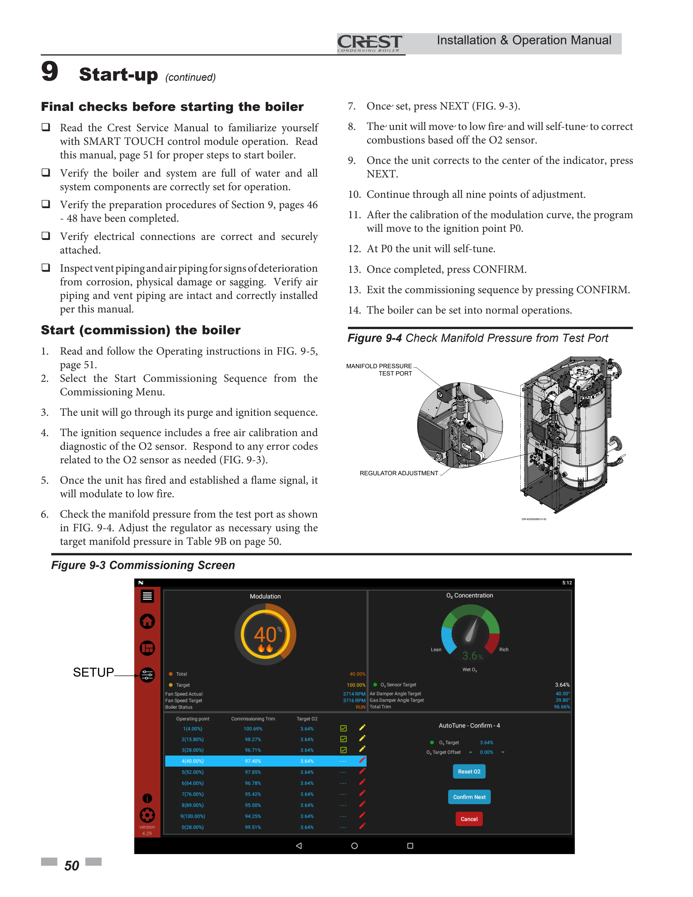

# Project Proposal
## Automated Combustion Commissioning and Optimization for the Lochinvar Hellcat Combustion System
#### Customer: Lochinvar Corporation
#### Instructor: Christopher Johnson
#### Project Supervisor: Ben Putnam
#### Team Members: Daniel Craig, Charles Lutz, Alex Marquez, Ethan Davenport
#### Course: ECE 4961 Capstone Design 1
#### Date: 10/09/2026

## 1. Introduction
Commercial boiler combustion systems must maintain an appropriate relationship between fuel
and combustion air over the entire operating range of the equipment. An improperly adjusted fuel-
to-air mixture can reduce efficiency, increase emissions, produce unstable combustion, or create
unsafe operating conditions. For this reason, commissioning a commercial combustion system
requires careful adjustment and verification at multiple operating points.
The Lochinvar CREST boiler equipped with Hellcat™ Combustion Technology already incorporates
several technologies intended to address this problem. The system uses independent air and gas
dampers, an oxygen sensor, feedforward control, feedback control, commissioned trim, and
learned trim to maintain a desired combustion condition. Lochinvar describes the Hellcat system
as using real-time O₂ feedback and environmental information to maintain a targeted combustion
O₂ range.
Despite these capabilities, the initial commissioning process still requires determining appropriate
combustion settings. Lochinvar's service documentation describes a commissioning procedure in
which the combustion system is adjusted at nine control points across the modulation range. The
proposed capstone project will investigate whether this process can be augmented with an
automated optimization procedure capable of systematically evaluating air and fuel settings and
identifying an optimal operating point while remaining within manufacturer-specified limits.
The proposed system will collect combustion and operating data, vary allowable control
parameters in a controlled manner, evaluate the resulting combustion performance, and
determine the settings that provide the desired combination of combustion efficiency, emissions
performance, stability, and repeatability. The system will also provide a documented
commissioning record so that the resulting settings can be reviewed by qualified personnel.
The project is therefore not intended to replace the Hellcat combustion control system or its safety
controls. Instead, it will serve as an engineering optimization and commissioning tool that can
assist qualified personnel in determining appropriate combustion settings.

### 1.1 Proposal Scope
This proposal defines the background and engineering problem, identifies applicable
specifications and constraints, surveys existing combustion-control technologies, establishes
measurable success criteria, describes the required resources and timeline, and discusses the
economic, environmental, safety, and ethical implications of the proposed solution.

## 2. Formulating the Problem

### 2.1 Problem Statement
Commissioning a commercial gas-fired boiler requires establishing an appropriate fuel-to-air
relationship over the boiler's operating range. The optimum relationship is not necessarily a single
fixed ratio because combustion performance is affected by firing rate, air conditions, fuel
conditions, venting, and other operating parameters.
Lochinvar's Hellcat system already provides independent control of the combustion of air and fuel
supply. Lochinvar identifies the air damper and gas damper as independent means of controlling
the air and fuel supply, respectively. The system also uses an O₂ sensor to provide combustion
feedback.

The challenge addressed by this project is the development of an automated method for
determining appropriate commissioning settings without requiring an operator to manually search
through numerous combinations of combustion parameters.

The proposed system shall:

- Automatically collect relevant combustion and operating data from the Hellcat combustion
system during commissioning.
- Evaluate combustion performance over the permitted operating range of the boiler.
- Determine an optimized set of combustion parameters for each required commissioning
point.
- Maintain all combustion adjustments within limits established by Lochinvar and applicable
standards.
- Monitor O₂ and other available combustion measurements during optimization.
- Detect unacceptable or unstable combustion conditions and terminate optimization when
necessary.
- Prevent the optimization system from bypassing, disabling, or overriding required safety
interlocks.
- Record measured operating conditions, tested settings, and selected settings for later
review.
- Produce a commissioning report documenting the resulting parameters and performance.
- Demonstrate that the automated procedure can produce repeatable results when
compared with an approved manual commissioning procedure.

The final system shall be considered an engineering commissioning and optimization tool and shall
not independently certify the boiler as safe for commercial operation.

### 2.2 Stakeholders

**Lochinvar Corporation — Project Sponsor and Customer**

Lochinvar Corporation is the project's sole identified stakeholder and the intended recipient of the automated commissioning system. The project's requirements and measures of success are based on Lochinvar's needs and expectations.

Lochinvar's primary needs and interests include:

- **Automated Commissioning:** Reduce the manual effort required to adjust air and gas damper positions across the required modulation range.
- **Combustion Performance:** Identify operating settings that meet the approved combustion and performance requirements at the required operating points.
- **Repeatability:** Produce consistent commissioning results when testing is performed under equivalent operating conditions.
- **Data Collection:** Record relevant measurements, actuator positions, blower speed, modulation level, and operating conditions for analysis and verification.
- **Safety and Operating Limits:** Ensure the optimization process operates within approved equipment limits and does not bypass existing combustion safety functions.
- **Verification and Documentation:** Provide documented test results that demonstrate whether the system meets its specified performance requirements.

The project will address these needs by developing an automated process that evaluates operating conditions, adjusts permitted settings, records measurement data, and verifies results against defined acceptance criteria. Project specifications and verification procedures will be aligned with Lochinvar's requirements and reviewed with the project sponsor as needed.

## 3. Background

### 3.1 Combustion Optimization
Combustion requires fuel and oxygen to be supplied in an appropriate proportion. In an ideal
stoichiometric reaction, the theoretical quantity of oxygen required for complete combustion is
supplied.
Practical combustion systems generally operate with excess air because perfect mixing cannot be
achieved and because insufficient air can result in incomplete combustion.
ASHRAE identifies excess air as an important combustion parameter and explains that excessive
air increases heat losses while insufficient air can increase incomplete combustion and carbon
monoxide production. Consequently, combustion efficiency is generally improved by operating
with the minimum excess air consistent with complete and stable combustion.

For gas-fired equipment, oxygen concentration in the exhaust can be used as an indicator of
excess air. Carbon monoxide must also be considered because an apparently efficient combustion
condition can still be unacceptable if insufficient air produces excessive CO.
The optimization problem can therefore be represented conceptually as:

  Optimal Combustion =
  <i>f</i>(Air Setting, Fuel Setting, Firing Rate, O2, CO, Stability, Efficiency)

The objective of the proposed system will be to determine the combination of controllable
parameters that produces the best acceptable combustion condition rather than simply
maximizing or minimizing one measurement.

## 4. Existing Hellcat Technology

#### Independent Air and Gas Control
The Hellcat combustion system uses an air damper and gas damper to independently control
combustion air and fuel. This architecture provides the ability to investigate the relationship
between the two variables during commissioning.

#### O₂ Feedback
The Hellcat system incorporates an O₂ sensor specifically designed for its condensing hydronic
boiler application. Lochinvar states that the sensor provides real-time information regarding the
combustion condition.

#### Feedforward Control
The system accounts for environmental conditions such as changes in air conditions. Lochinvar
describes its feedforward system using environmental measurements to help establish the
appropriate air/fuel mixture.

#### Commissioned Trim
The existing system allows commissioning adjustments to be established for multiple operating
points. Lochinvar documentation describes nine control points that can be individually adjusted
during the commissioning process.

#### Learned Trim
The Hellcat control system can retain information about successful operating conditions and use
that information during subsequent operation. Lochinvar describes this as a learned trim and
states that the control system can use historical environmental information to maintain
combustion performance.
These existing technologies provide an important foundation for the proposed project. Rather than
designing a combustion controller from the ground up, the project will investigate an automated
optimization layer capable of determining appropriate commissioning parameters.

### 4.1 Existing Hellcat Technology - Hardware Update
The sponsor has supplied technical drawings for the intake assembly, both damper actuators, and
two candidate blower references. The project will use these documents to establish the electrical
and mechanical interfaces before implementing closed-loop commissioning. These are
component references, not evidence that a fully functioning burner test system has been
assembled.
#### Intake and gas-valve assembly
A.O. Smith / Lochinvar intake assembly (part 1001303976, FCB1500-2000) contains:

- Siemens air-intake valve (100308435) with VA33.11A-U3220G9 actuator
- Siemens gas butterfly valve (100308437) with VA33.VKG-28G actuator
- Gas-valve flange (100308438) and AGF150 geometry

The air actuator is rotated 90°relative to the gas actuator. The air-intake valve drawing indicates a
24-hole circular flange pattern, ~9.41 in. outside diameter, and a 4.369 in. air damper blade. The
gas-valve features a 1.100 in. damper blade with an O-ring seal. Dimensions are drawing
references; final fit and required clearances will be verified against the provided hardware.

*Figure 4A. Sponsor-provided intake assembly drawing and bill of materials.*
#### Proposed installation controls
Any mechanical adjustment, shaft movement, or valve command must be performed first with the
fuel supply isolated and under an approved test plan. Geometry and installation orientation must
not be inferred from the control-table percentages alone.

### 4.2 Existing Hellcat Technology – Actuators and Blowers
#### Actuation and position feedback
The Siemens air and gas actuators are the proposed positioning devices for the independent air
and fuel paths. The sponsor also provided a detailed 24 VDC motorized actuator drawing with
nominal 90-degree operating travel, direction/duty-cycle command information, and open/close
feedback channels. Its exact compatibility with the supplied Siemens valve actuators has not yet
been established; these items will be checked at the electrical-interface stage.

*Figure 4B. Siemens gas butterfly actuator detail (VA33.VKG-28G).*
#### Blower candidates and drive interface

The supplied 8.9-in A.O. Smith fan drawings identify blower assembly references 100144909 and
100347594, rated for 120 VAC single-phase at 50/60 Hz, with a separate low-voltage control
interface. The drawing identifies a PWM command line, tachometer output, DC-voltage pin, and
common reference; the line-power input must remain electrically isolated from the controller.
The additional AMETEK Nautilair 12.3-in reference describes 240 VAC blowers with mechanical, 0-
10 VDC, or PWM speed controls depending on model (150540, 150541, or 150542). This is
reference literature, not proof that the project uses the 12.3-in unit. The sponsor cost sheet lists
100144909 as the currently supplied blower; its interface should drive the first prototype.

*Figure 4C. Sponsor-supplied 8.9-in blower assembly and signal/power connector diagram.*

The blower tachometer is a measurement signal and must be scaled using the verified number of
pulses per revolution. Wiring, voltage levels, current demand, and signal conditioning must be
verified against the exact hardware revision before connection.
The exact signals available to the project shall be confirmed with Lochinvar before hardware and
software implementation.

### 4.3 Optimization
- Establish initial operating conditions.
- Verify that the boiler is operating normally.
- Modify only permitted parameters.
- Allow the combustion system to stabilize.
- Measure the resulting combustion condition.
- Calculate a performance metric.
- Determine whether the new setting is better or worse.
- Continue until an optimum or acceptable solution is identified.
- Stop immediately if an unsafe or prohibited condition occurs.

### 4.4 Safety
The system shall not:

- Disable safety interlocks.
- Bypass flame-proving functions.
- Override required lockouts.
- Operate outside manufacturer-defined combustion limits.
- Intentionally operate the burner under known unsafe combustion conditions.
- Modify safety-critical parameters without explicit authorization from the customer and
qualified personnel.

Lochinvar's service documentation demonstrates that the existing control system performs
multiple checks during startup and operation, including damper position verification, flame
verification, safety-state checks, and O₂ monitoring where applicable.

The capstone system shall therefore operate as a supervised optimization layer rather than as a
replacement for these safety functions.

## 5. Specifications and Constraints

### 5.1 Project Specifications

#### Combustion Optimization
- The system shall determine optimized combustion settings for each required
commissioning operating point.
- The system shall evaluate both combustion performance and safety-related
measurements rather than optimizing O₂ alone.
- The system shall provide a repeatable optimization procedure such that repeated
commissioning runs under substantially identical conditions to produce results within an
agreed-upon tolerance.
#### Data Acquisition
The system shall record, where available:

- Air damper position
- Gas damper position
- Firing rate or modulation percentage
- O₂ concentration
- CO concentration
- CO₂ concentration
- Exhaust/flue temperature
- Combustion air temperature
- Ambient/barometric conditions
- Gas pressure
- Relevant boiler operating parameters
- Time associated with each measurement

## 6. Constraints

### 6.1 Manufacturer Constraints

The Lochinvar installation, operation, and service documentation shall take precedence over
experimental assumptions. Gas-valve and combustion adjustments shall follow the
manufacturer's approved commissioning procedure.
Lochinvar specifically states that normal gas-valve adjustment should not be required, and that
adjustment should be performed as part of the commissioning sequence.

### 6.2 Combustion Safety
The system handles a fuel-burning appliance capable of producing hazardous combustion
products. An optimization algorithm therefore cannot be allowed to trade safety for efficiency.
Carbon monoxide is particularly important because incomplete combustion can result from
insufficient air or poor fuel/air mixing. ASHRAE identifies incomplete combustion as both an
efficiency concern and a safety concern because of the potential for CO production.

### 6.3 Regulatory Requirements
The project shall account for applicable fuel-gas, boiler, electrical, and combustion-safety
requirements. NFPA 54, the National Fuel Gas Code, establishes minimum safety requirements for
fuel-gas piping systems.
CSA/ANSI Z21.13-22/CSA 4.9-2022 applies to gas-fired low-pressure steam and hot-water boilers
within its stated scope and includes construction and performance requirements.
The exact standards applicable to the experimental installation shall be confirmed with Lochinvar
and the project supervisor before testing begins.

### 6.4 Hardware Constraints
The system must interface with the available Hellcat hardware without damaging or permanently
modifying the boiler. Where possible, measurements should be obtained through approved
electrical, communication, or diagnostic interfaces rather than invasive modification.

### 6.5 Testing Constraints
Testing must be performed in an appropriately controlled environment under the supervision of
qualified personnel. The project shall not intentionally test combustion conditions that fall outside
approved manufacturer operating limits merely to demonstrate the optimization algorithm.

## 7. Survey of Existing Solutions

### 7.1 Manual Commissioning
Traditional boiler commissioning relies on a trained technician adjusting combustion parameters
while observing combustion measurements. The advantage of this method is that a qualified
technician can consider information that may not be captured by an automated algorithm.
However, manual optimization can be time-consuming and may introduce variation between
technicians. The Hellcat system already improves traditional approaches by providing a
touchscreen commissioning process and multiple commissioning points.

### 7.2 Hellcat RealTime O₂ Trim
The Hellcat system is an advanced solution to combustion control. It combines feedforward and
feedback information and targets a specified combustion O₂ range. Lochinvar states that
commissioned trim allows the desired O₂ setting to be programmed while learned trim helps
maintain performance under changing environmental conditions.
This represents the closest existing solution to the proposed project. The proposed capstone
differs by focusing specifically on automating the commissioning optimization process rather than
developing another continuous combustion-control algorithm.

### 7.3 Closed-Loop Optimization
A broader engineering approach is to use measured system outputs as feedback to an optimization
algorithm. A generic closed-loop process is:
Initial Settings → Adjust Air / Fuel → Allow System to Stabilize → Measure O₂ / CO / Temperature
/ Load → Calculate Objective Function → Check Limits → Continue Search or Stop → Select Best Valid Setting

The proposed project will investigate whether such an approach can reduce commissioning time
while maintaining or improving combustion performance.

## 8. Proposed Solution
The proposed system will consist of four primary subsystems:

- Data acquisition
- Control/interface hardware
- Optimization software
- Operator interface and reporting

### 8.1 Data Acquisition
The data-acquisition subsystem will collect combustion and operating parameters from the boiler.
The most important feedback variable is expected to be O₂ concentration because it directly
represents the combustion air condition. CO and CO₂ measurements may also be incorporated
depending on the available instrumentation. Combustion air and environmental measurements
will also be recorded because combustion performance can change as operating conditions
change.

### 8.2 Control Interface
The control interface will provide the optimization software with access to the permitted air and
fuel control variables. The preferred implementation will use an existing supported interface
whenever possible. Any direct connection to the boiler controls will be reviewed and approved by
the customer before implementation.

### 8.3 Optimization Algorithm
The optimization algorithm will treat the air and fuel settings as adjustable variables.

$$
\mathbf{x} =
\begin{bmatrix}
\theta_{\mathrm{air}} \\
\theta_{\mathrm{gas}}
\end{bmatrix}
$$

where $\theta_{\mathrm{air}}$ is the air damper position and $\theta_{\mathrm{gas}}$ is the gas damper position. The algorithm will
evaluate each candidate's operating condition using a performance function.

$$
J = w_1 E_{O_2} + w_2 E_{CO} + w_3 E_{\eta} + w_4 E_{\mathrm{stability}}
$$

Where $E_{O_2}$ represents deviation from the desired O₂ condition, $E_{CO}$ represents undesirable CO
production, $E_{\eta}$ represents combustion-efficiency loss, $E_{\mathrm{stability}}$ represents instability or excessive
variation, and $w_1$ through $w_4$ are weighting factors.
The exact objective function will be established using manufacturer requirements and
experimental results. The optimization algorithm will only consider candidate points that satisfy all
mandatory safety and operating constraints.

### 8.4 Proposed Solution – Operating-Curve Update
The sponsor supplied the commissioning lookup table for a 1,000,000 BTU/h boiler. It contains
ignition point 0 and nine named modulation points (1-9). The air-damper and gas-damper entries
are sponsor-provided field values; the units and mapping to absolute angles must be verified rather
than assumed. Fan speeds are presented in RPM.

| Point | Modulation | Air Nat | Gas Nat | Fan Nat (RPM) | Air LP | Gas LP | Fan LP (RPM) |
|---:|---:|---:|---:|---:|---:|---:|---:|
| 0 | 27% | 36.8 | 38 | 4142 | 36.5 | 31.8 | 4265 |
| 1 | 5% | 18.2 | 15.9 | 3020 | 18.2 | 12.4 | 3013 |
| 2 | 16% | 30.2 | 29.7 | 3484 | 30.2 | 24.5 | 3553 |
| 3 | 27% | 36.8 | 38 | 4142 | 36.5 | 31.8 | 4265 |
| 4 | 39% | 44.5 | 44.4 | 4510 | 44.7 | 37.7 | 4560 |
| 5 | 53% | 50 | 50.5 | 5288 | 50 | 43 | 5435 |
| 6 | 65% | 56 | 54.6 | 5704 | 56 | 46.8 | 5890 |
| 7 | 76% | 63.6 | 58.3 | 5893 | 63.2 | 49.7 | 6064 |
| 8 | 89% | 70.2 | 63.1 | 6623 | 74.5 | 53.5 | 6700 |
| 9 | 100% | 90 | 70.7 | 7259 | 90 | 57.9 | 7323 |

Table 8A. Sponsor operating references for natural gas (Nat) and liquid propane (LP). Values reproduced from the supplied spreadsheet.
#### Control-law starting point
For a requested firing modulation between two applicable named points, the initial feedforward
targets may be computed by piecewise-linear interpolation:

$$
u(m) = u_i + \frac{(u_{i+1} - u_i)(m - m_i)}{m_{i+1} - m_i}
$$

Here, $u$ represents the air-damper setting, gas-damper setting, or blower RPM. Point 0 is an ignition
condition and is not an ordinary segment of the normal modulation curve.
The three commands must be synchronized; a plausibility monitor should compare command
values and feedback, impose limits on movement/ramp rate, and inhibit commissioning if a
commanded component fails to track. Feedforward lookup values are baseline references, not
automatically optimized combustion settings.
### 8.5 Additional Sponsor-Provided Configuration

| Parameter | Natural gas | LP / shared reference |
|---|---:|---:|
| Purge blower speed | 6,623 RPM | 6,623 RPM |
| Feedforward premix | 75.2 | 75.2 |
| Feedforward barometric reference | 989.5 | 994.1 |
| Fan pulses/revolution | 2 | 2 |
| Fan spike mask | 8 | 8 |

The spreadsheet also lists observed values and controller settings: air damper 18.2-90 versus
settings 17.7-90; gas damper 12.4-70.7 versus settings 11.9-75.7; blower 3,013-7,323 RPM versus
settings 1,350-17,000. These should be recorded as provided, without interpreting them as
validated safe operating boundaries.

### 8.6 Proposed Solution – Controller and I/O Architecture
The sponsor recommends first evaluating a Raspberry Pi or Arduino-class controller rather than
designing a custom board. A custom embedded controller remains a potential alternative only if a
documented interface, timing, or signal-integrity requirement cannot be met by a commercial
development platform. The choice should be justified by time to integration, reliable I/O, and the
ability to implement the control algorithm.
#### Preliminary interface allocation (subject to verification)

| Function | Interface / design issue |
|---|---|
| Existing SQM33 units (two) | Identify exact electrical protocol, power, position command, and feedback from equipment documentation; do not assume generic PWM or 0–10 V support. |
| 8.9-in blower, 100144909 | Line-powered 120 VAC unit with low-voltage PWM/tach connector. Confirm PWM level, frequency, tach signaling, and electrical isolation. |
| Modulation demand | One isolated 0–10 V or 0/4–20 mA input, selected after sponsor approval. |
| O₂ feedback | One conditioned/isolated analog input (0–10 V or 0/4–20 mA as appropriate for the sensor). Confirm scaling and sensor validity. |
| Auxiliary status | Safety-status and operating-permission read-only inputs where the manufacturer permits access. |
| Operator/data logging | Local user interface, time-stamped traces, baseline comparisons, and error reports. |
#### Software sequence
1. Check communication, calibrated position feedback, sensor health, fuel selection,
approved limits, and external boiler permissives.
2. Establish the sponsor-defined ignition/starting state only through the existing listed boiler
controls.
3. At a permitted modulation point, command the synchronized feed forward air, gas, and
blower targets.
4. Allow the original system to settle, then observe O₂ and other valid combustion/safety
measurements.
5. Propose a bounded correction, log the result and compare it to the last accepted baseline.
6. Repeat at the remaining approved operating points, saving accepted results for review.
7. Revert to the last authorized safe state or terminate the procedure upon communication,
feedback, or safety fault.
This commissioning application is a supervisory research layer, not a substitute for the certified
combustion control and flame-safeguard system. No external program may bypass interlocks,
directly force ignition, or authorize unsafe gas-valve positions.
### 8.7 Open technical items
Confirm SQM33 model/protocol, actual damper calibration and feedback range, blower signal
levels and tach scaling, O₂ sensor output/scaling, controller I/O expansion and isolation, electrical
protection, and sponsor-approved test access. Hardware specifications not explicit in the supplied
drawings remain to be verified.

## 9. Measures of Success

### 9.1 Primary Success Criteria
The project shall be considered successful if the completed system:

- Successfully communicates with the test system.
- Collect all required measurements.
- Automatically evaluates multiple combustion settings.
- Identifies a valid combustion setting at each required operating point.
- Maintains operation within approved manufacturer limits.
- Detects unacceptable combustion conditions.
- Produces repeatable results.
- Generates a record of the commissioning process.

- Demonstrates a measurable reduction in manual commissioning effort.

### 9.2 Optimization Accuracy
The automated system's selected operating points will be compared against settings established
using the approved manual commissioning procedure. The comparison will include O₂
concentration, CO concentration, CO₂ concentration, damper positions, firing rate, exhaust
temperature, calculated efficiency, and stability.
The acceptance tolerance for each parameter will be determined with the customer and supervisor
after the exact Hellcat model and available instrumentation are confirmed.

### 9.3 Repeatability
At least three optimization runs should be conducted under substantially identical operating
conditions. The resulting optimized parameters will be compared to determine whether the
algorithm converges to similar solutions.
A proposed preliminary target is that repeated runs produce combustion measurements within
±[X]% of the established reference values and control settings within ±[X] degrees or % position,
subject to confirmation by the customer.

### 9.4 Commissioning Time
The time required for automated commissioning will be compared with the time required for an
approved manual commissioning procedure. The desired outcome is Tautomated < Tmanual while
maintaining equivalent or improved combustion performance. The final percentage reduction
target will be established after baseline manual commissioning data are collected.

## 10. Experimental Methodology

#### Stage 1 — Baseline
The boiler will be commissioned using the approved existing procedure. Measurements will be
recorded at each required operating point. This establishes the reference data against which the
automated system will be evaluated.

#### Stage 2 — Instrumentation Verification
The project's sensors and data-acquisition equipment will be compared against known or trusted
measurements. Sensor errors and offsets will be documented before optimization testing begins.

#### Stage 3 — Automated Search
The algorithm will test allowable combinations of air and fuel settings. Each setting will be allowed
sufficient time for the system to stabilize before measurements are evaluated.

#### Stage 4 — Optimization
The algorithm will identify the best valid setting according to the established objective function.
Invalid or unsafe points will be rejected rather than incorporated into the optimization result.

#### Stage 5 — Repeatability

The optimization procedure will be repeated under equivalent operating conditions. The resulting
settings and combustion measurements will be statistically compared.

#### Stage 6 — Environmental Testing
Where practical and safe, the system will be tested under different environmental conditions to
determine whether the optimization process remains effective when air temperature, pressure, or
other operating variables change.
The provided Lochinvar commissioning instructions show a conventional workflow: verify
preparation and system readiness; initiate the commissioning sequence; run purge and ignition
under the original control; validate O₂ sensing; check manifold pressure and other required
indicators; then allow the control to self-tune through the operating points. The sample
commissioning screen shows target O₂ and measured O₂ plus progression through individual firing
points. These figures establish the user workflow, not an independently verified communications
interface.

*Figure 10A. Sponsor-provided reference screen and startup/commissioning instructions.*

#### Updated testing method
The project will record an approved manual or existing Hellcat commissioning baseline before
automated trials. Initial bench tests will use simulated modulation and O₂ inputs, valve/actuator
position monitoring, and blower feedback without energized combustion. Subsequent controlled
testing, if authorized, will evaluate each approved modulation point and compare manual versus
automated commissioning time, repeatability, O₂ error, measured combustion quality, and
stability.

The student controller will only recommend or apply changes through an approved interface and
under supervision. It will not bypass the boiler controller, burner management system, gas-safety
components, or operator authorization. Acceptance criteria for emissions and safe operating limits
must come from manufacturer's documentation and qualified personnel, not from the feedforward
spreadsheet.

## 11. Resources

### 11.1 Hardware

| Resource | Purpose | Estimated cost |
|---|---|---:|
| Data-acquisition hardware | Collect combustion/system measurements | $500–$1,500 |
| Industrial computer or controller | Run optimization software | $500–$1,500 |
| O₂ measurement equipment | Verify combustion O₂ | $500–$2,000 |
| CO/combustion analyzer | Verify combustion safety/performance | $1,000–$3,000 |
| Pressure measurement equipment | Verify gas/air pressure | $200–$800 |
| Temperature sensors | Environmental and combustion measurements | $100–$400 |
| Electrical/interface hardware | Interface with boiler controls | $200–$800 |
| Safety equipment | Controlled testing | $200–$500 |
| Wiring/connectors/enclosure | Prototype construction | $200–$500 |
| Miscellaneous/prototyping | Mechanical/electrical fabrication | $300–$750 |
| **Estimated Total** | **Preliminary equipment budget** | **$3,700–$11,750** |

The final cost is expected to be substantially lower if Lochinvar provides existing instrumentation,
control hardware, test equipment, or access to an existing development system.

### 11.2 Software
- Python or MATLAB for algorithm development
- Data-analysis software
- PLC/controller programming environment, if required
- Communication/interface software
- Version-control software
- Spreadsheet software for test-data analysis

Existing university and customer software licenses will be used whenever possible to minimize
project cost.

### 11.3 Resources – Sponsor Hardware and Budget Update

The sponsor has confirmed that physical components are available and provided part drawings
and a running project cost sheet. Items specifically classified as Lochinvar parts or purchased for
the boiler are treated as donated project resources; independently ordered prototype/interface
components remain chargeable to the student project.

#### Confirmed sponsor-provided equipment

| Qty | Part number | Description | Reference value | Budget treatment |
|---:|---|---|---:|---|
| 1 | 100304496 | Intake assembly | $952 | Lochinvar donated |
| 1 | 100144909 | 8.9-in blower | $497 | Lochinvar donated |
|  |  | **Total in-kind reference value** | **$1,449** | **Not cash expenditure** |

The original preliminary resource table on proposal in section 11.1 is a planning estimate, not a
confirmed purchase order. Its $3,700-$11,750 estimate should now be interpreted alongside the
available sponsor donations; the exact revised out-of-pocket total cannot be determined until the
selected controller, I/O modules, test instruments, connectors, and sensors are priced.
#### Items to scope and price after I/O review

| Category | Procurement status |
|---|---|
| Controller (Raspberry Pi / Arduino alternative) | Select after verifying communication ports, real-time behavior, and environmental requirements. |
| I/O expansion, isolation, ADC/DAC or analog converters | Required quantity and ranges depend on SQM33, O₂ sensor, and load-signal interfaces. |
| Blower command and tach interface | Level shifting, isolation, and pulse measurements are specified from verified hardware. |
| Low-voltage supplies, fusing, cables, connectors, enclosure | Specify based on the actual wiring drawings and safe electrical installation. |
| Measurement/analysis equipment | Use sponsor or university equipment where available; obtain permission before purchasing. |
#### Sponsor-requested project scope adjustments
The sponsor cannot provide the previously anticipated source code for the existing control. The
team will therefore develop an independent controller application using documented interfaces
and the provided modulation lookup table. The first milestone is a verified I/O inventory and
controller recommendation, followed by a safe bench-top communications demonstration, then

software implementation and controlled validation. This scope change reduces dependence on
proprietary source code but adds interface-discovery and verification work.
New figure and specification references include: Siemens/A.O. Smith air and gas actuator
drawings, the intake assembly BOM, the A.O. Smith 8.9-in blower drawing, AMETEK Nautilair
reference curves, the sponsor-provided Nat/LP operating sheet, and the Lochinvar commissioning-
screen instruction extract.

The multidisciplinary nature of these requirements is a primary reason for completing the project
as a multi-person engineering capstone.

## 12. Personnel

### 12.1 Required Skills
- Embedded systems
- Electrical engineering
- Control systems
- Data acquisition
- Software development
- Numerical optimization
- Thermodynamics
- Combustion
- Instrumentation
- Electrical safety
- Technical documentation
- Experimental design
- Data analysis

### 12.2 Team Skills

| Skill | Current team capability | Required level | Gap |
|---|---|---|---|
| Embedded systems | [Describe] | High | [Low/Medium/High] |
| Electrical systems | [Describe] | High | [Low/Medium/High] |
| Programming | [Describe] | High | [Low/Medium/High] |
| Control systems | [Describe] | High | [Low/Medium/High] |
| Combustion | [Describe] | Medium/High | [Low/Medium/High] |
| Thermodynamics | [Describe] | Medium/High | [Low/Medium/High] |
| Data analysis | [Describe] | Medium/High | [Low/Medium/High] |
| Mechanical systems | [Describe] | Medium | [Low/Medium/High] |

Any identified knowledge gaps will be addressed through manufacturer documentation,
consultation with Lochinvar personnel, academic resources, laboratory testing, and review with
the project supervisor.

## 13. Timeline
The project will be completed in phases so that hardware development does not begin before the
combustion-system requirements and safety constraints are understood.

| Phase | Major tasks | Approximate duration |
|---|---|---|
| Requirements | Customer requirements; Hellcat documentation review; safety/interface analysis | September–October 2026 |
| Research and Design | Existing solution research; system architecture; optimization methodology | September–November 2026 |
| Prototype | Hardware selection; data-acquisition prototype; software development | October–December 2026 |
| Integration | Hardware/software integration; sensor validation; communication testing | December 2026–January 2027 |
| Testing | Baseline commissioning; automated optimization; repeatability; validation | January–March 2027 |
| Final Deliverables | Data analysis; final documentation; final presentation | March–April 2027 |

A professional Gantt chart will be generated using the official university capstone dates once the
semester milestones are confirmed.

## 14. Specific Implications
The primary customer benefit is expected to be a reduction in the time and effort required to
commission the combustion system.
Manual combustion commissioning requires a qualified technician to adjust and evaluate multiple
operating points. Lochinvar's existing Hellcat documentation describes nine individual control
points that can be adjusted during commissioning. Automating portions of this search could
reduce the number of manual adjustments required and provide a consistent procedure between
commissioning events.

### 14.1 Reduced Commissioning Time
An optimization algorithm can systematically test candidate conditions without requiring a
technician to manually perform every adjustment.

### 14.2 Improved Repeatability
A software-based procedure can apply the same optimization methodology each time, reducing
variation caused by differences between technicians.

### 14.3 Better Documentation
The system can automatically record initial settings, tested settings, combustion measurements,
environmental conditions, selected settings, optimization results, and faults or rejected operating
points.

### 14.4 Improved Combustion Performance
The optimization process will attempt to identify operating conditions that maintain the desired
combustion characteristics while minimizing unnecessary excess air and avoiding incomplete
combustion. ASHRAE identifies minimizing excess air, while maintaining complete combustion, as
an important factor in reducing flue losses and improving combustion efficiency.

### 14.5 Reduced Service Requirements
A more repeatable commissioning procedure could reduce the amount of time technicians spend
diagnosing combustion conditions and manually searching for acceptable settings.

### 14.6 Potential Energy Savings
Improved combustion performance can reduce fuel losses. The actual energy savings will be
measured rather than assumed and will depend on the baseline combustion condition and
operating profile.

## 15. Broader Implications, Ethics, and Responsibility as Engineers

### 15.1 Safety
The most significant ethical consideration is human safety. The project interacts with a combustion
system capable of producing high temperatures, pressurized fuel, and hazardous combustion
products. A design that improves efficiency but increases the risk of unsafe combustion would not
constitute a successful engineering solution.
The optimization algorithm must therefore treat safety limits as hard constraints rather than
optimization targets.

CO &lt; COmax

O2,min &le; O2 &le; O2,max

The actual limits will be established using the applicable Lochinvar documentation and standards.

### 15.2 Environmental Impact
Improved combustion can potentially reduce fuel consumption and emissions. However,
optimization must be considered more than fuel efficiency. Operating with insufficient air can
increase incomplete combustion and CO production, while excessive air can increase heat losses.

The proposed system will therefore evaluate emissions and efficiency together rather than
optimizing a single variable.

### 15.3 Economic Impact
A reduction in commissioning labor can provide economic benefits to the customer and
technicians. Improved repeatability may also reduce troubleshooting time and service costs.
However, the project must demonstrate these benefits using measured data rather than assuming
that automation will automatically produce economic savings.

### 15.4 Professional Responsibility
The engineering team has a responsibility to recognize the limits of the proposed system. The
project team shall not claim that the system is certified, production-ready, or suitable for
unsupervised commercial boiler operation unless the necessary testing, certification, and
customer approval have been completed.
The team shall also document known limitations and failure modes.

### 15.5 Cybersecurity and Control Integrity
If the system communicates digitally with the boiler controller, cybersecurity and control integrity
must be considered. Unauthorized modification of combustion parameters could potentially
create unsafe conditions. Communication interfaces shall therefore be protected from unintended
commands, and the system shall fail safely if communication is interrupted.

## 16. Risk Assessment
| Risk | Severity | Probability | Mitigation |
| :--- | :--- | :--- | :--- |
| Excessive CO during testing | High | Medium | Hard CO limits, qualified supervision, automatic abort |
| Flame instability | High | Medium | Monitor flame/safety status and terminate test |
| Incorrect damper command | High | Low/Medium | Command limits and independent validation |
| Sensor failure | High | Medium | Sensor plausibility checks and redundant verification |
| Communication failure | Medium/High | Medium | Fail-safe communication timeout |
| Incorrect optimization result | Medium | Medium | Compare against manual commissioning baseline |
| Hardware damage | Medium | Low | Current/voltage limits and approved interfaces |
| Excessive testing time | Low/Medium | Medium | Establish test boundaries and optimization limits |
| Software error | High | Medium | Simulation, unit testing, limits, supervised operation |
| Environmental variation | Medium | High | Record environmental parameters and test repeatability |

## 17. Expected Final Deliverables
- An operational prototype of the automated commissioning system.
- Data-acquisition hardware and software.
- An optimization algorithm.
- A user interface or control interface.
- Automatic data logging.
- Automated commissioning reports.
- Experimental validation data.
- Comparison between manual and automated commissioning.
- A documented safety strategy.
- Final engineering documentation.
- Demonstration of the system to the customer and faculty.

## 18. References
1. Lochinvar. “Crest® Condensing Boiler with Hellcat™ Combustion Technology.” Lochinvar
Corporation.
2. Lochinvar. “Crest® with Hellcat™ Combustion Technology — Product Prospectus.”
Lochinvar Corporation.
3. Lochinvar. “Hellcat Service Manual, 100343237_2000600598, Rev. C.” Lochinvar
Corporation.
4. Lochinvar. “Crest with Hellcat Combustion Technology — High Efficiency Product
Literature.” Lochinvar Corporation.
5. American Society of Heating, Refrigerating and Air-Conditioning Engineers (ASHRAE).
ASHRAE Handbook — Fundamentals, Chapter 28: Combustion and Fuels.
6. American Society of Heating, Refrigerating and Air-Conditioning Engineers (ASHRAE).
ASHRAE Handbook — Applications, Chapter 43: Supervisory Control Strategies and
Optimization.
7. American Society of Heating, Refrigerating and Air-Conditioning Engineers (ASHRAE).
ASHRAE Handbook — Systems and Equipment, Chapter 32: Boilers.
8. National Fire Protection Association. NFPA 54: National Fuel Gas Code.
9. CSA Group / American National Standards Institute. CSA/ANSI Z21.13-22 / CSA 4.9-2022:
Gas-Fired Low-Pressure Steam and Hot Water Boilers.
10. ASHRAE. ASHRAE Standard 202: The Commissioning Process for New Buildings and New
Systems.

## 19. Statement of Contributions
Each team member is responsible for accurately documenting their individual contributions to the
proposal.

[Team Member 1 — Name] [Team member should describe their own contributions here.
Examples may include system architecture, hardware research, combustion-system research, or
proposal development.]

[Team Member 2 — Name] [Team member should describe their own contributions here. Examples
may include system architecture, hardware research, combustion-system research, or proposal
development.]

[Team Member 3 — Name] [Team member should describe their own contributions
here. Examples may include system architecture, hardware research, combustion-system
research, or proposal development.]

[Team Member 4 — Name] [Team member should describe
their own contributions here. Examples may include system architecture, hardware research,
combustion-system research, or proposal development.] Each team member confirms that the
contribution statement accurately represents the work personally completed for the proposal.

## 20. Conclusion
The proposed project will investigate an automated method for commissioning and optimizing the
fuel-to-air relationship of the Lochinvar Hellcat combustion system. The project will build upon
Hellcat's existing air and gas control, O₂ feedback, commissioned trim, and learned trim
technologies rather than attempting to replace the manufacturer's combustion-control
architecture.
The primary innovation will be the development of an automated optimization process capable of
systematically evaluating allowable combustion settings, measuring the resulting combustion
performance, and identifying an optimized setting at each required operating point.
The project will measure success through combustion performance, repeatability, commissioning
time, data quality, and adherence to safety requirements. Particular emphasis will be placed on
ensuring that optimization does not compromise combustion safety or manufacturer-required
operating limits.
If successful, the resulting system could provide Lochinvar with a more consistent, repeatable, and
data-driven approach to combustion commissioning. The project could reduce commissioning
time, improve documentation, and provide a foundation for further development of automated
commissioning technologies for commercial combustion systems.

